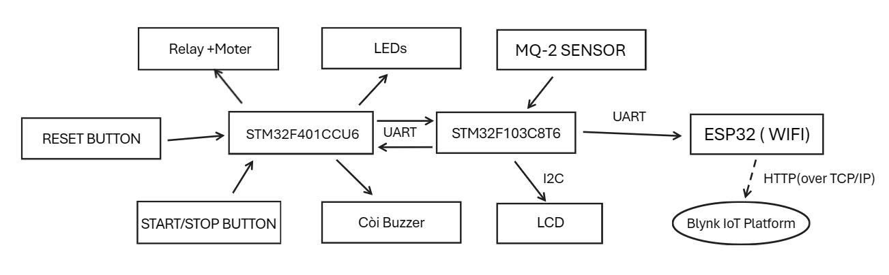

# Hệ thống phát hiện và cảnh báo rò rỉ khí gas LPG

Hệ thống nhúng ba thiết bị phát hiện rò rỉ khí gas LPG trong nhà, cảnh báo tại chỗ bằng đèn — còi — relay và gửi cảnh báo từ xa qua Wi-Fi. Đồ án môn học, viết bằng **C thao tác thanh ghi trực tiếp, không dùng HAL/LL**.

Đây là **bản khôi phục mã nguồn (V2)**: mã gốc đã mất, toàn bộ firmware được dựng lại từ bản báo cáo 51 trang của dự án (ràng buộc chân, sơ đồ ghép nối và thuật toán lấy từ đó), đồng thời sửa các lỗi phát hiện được trong quá trình đối chiếu.

> **Đây là dự án học thuật, không phải thiết bị an toàn được chứng nhận.** Không dùng thay cho đầu báo gas dân dụng đạt chuẩn. Xem [Trạng thái và giới hạn](#7-trạng-thái-và-giới-hạn) trước khi tin bất kỳ con số nào.

---

## 1. Sơ đồ khối



*Hình 1 — Sơ đồ khối chức năng, trích từ báo cáo gốc (trang 12).*

Ba thiết bị, mỗi thiết bị một nhiệm vụ:

| Thiết bị | Vai trò |
|---|---|
| **STM32F103C8T6** *(Producer)* | Đọc MQ-2 qua ADC, lọc nhiễu, quy đổi ra ppm, phân mức cảnh báo, hiển thị LCD, gửi trạng thái cho hai thiết bị còn lại |
| **STM32F401CCU6** *(Consumer)* | Nhận mã trạng thái, chạy máy trạng thái cảnh báo, điều khiển 4 LED + còi + tín hiệu relay, đọc công tắc Start/Stop |
| **ESP32** | Cầu nối Wi-Fi: nhận telemetry từ F103 rồi đẩy lên Blynk Cloud, gửi cảnh báo email và push notification |

Tách đo đạc khỏi điều khiển đầu ra là lựa chọn kiến trúc của đồ án. Hệ quả kéo theo: hai MCU phải đồng bộ trạng thái với nhau qua UART, và phần lớn lỗi khó nhất của dự án nằm đúng ở chỗ đồng bộ đó.

---

## 2. Cách hệ thống hoạt động

**Chu kỳ đo 1 giây** trên F103:

1. Lấy **21 mẫu ADC** cách nhau 10 ms.
2. Loại mẫu nằm ngoài dải hợp lệ, yêu cầu quá nửa số mẫu phải hợp lệ.
3. Quy đổi từng mẫu sang điện trở cảm biến `Rs`, lọc **3-sigma** rồi lấy **trung vị**.
4. Tính `ppm` từ tỉ số `Rs/R0` theo đường đặc tuyến LPG.
5. Phân mức cảnh báo có **hysteresis**, rồi phát mã trạng thái qua UART.

**Chuỗi quy đổi:**

```
V = raw / 4095 × 3300 mV        →  Rs = RL × (Vc − V) / V
ratio = Rs / R0                →  ppm = 574,25 × ratio^(−2,222)
```

**Bốn mức cảnh báo:**

| Mức | LPG | Ý nghĩa | %LEL xấp xỉ | Đầu ra |
|---|---|---|---|---|
| 0 | < 1000 ppm | Chưa vượt ngưỡng cảnh báo thiết kế | < 5 % | LED xanh dương |
| 1 | 1000 – 1499 ppm | Cảnh báo sớm | 5 % | LED vàng |
| 2 | 1500 – 1999 ppm | Cảnh báo cao | 7,5 % | LED đỏ nháy 1 Hz, còi, kích relay |
| 3 | ≥ 2000 ppm | Cảnh báo nghiêm trọng | 10 % | LED đỏ nháy nhanh dần 2→10 Hz, còi, kích relay |

Cơ sở của ba mốc: LPG chủ yếu gồm propane (LEL ≈ 21 000 ppm) và butane (LEL ≈ 19 000 ppm), lấy LPG tham chiếu ≈ 20 000 ppm nên `ppm = (%LEL/100) × 20000`. Phép quy đổi là **tính toán**; việc chọn đúng 5 / 7,5 / 10 % là **quyết định thiết kế của dự án**. EN 50194-1 quy định điểm kích hoạt thiết bị gia dụng nằm trong khoảng trên 3 % và dưới 20 % LFL — ba mốc này nằm trong khung đó, nhưng tiêu chuẩn **không bắt buộc** chia đúng ba mức, và hệ thống này không được chứng nhận theo tiêu chuẩn đó.

Mức 1 **không** có nghĩa đã đạt giới hạn cháy dưới. Dưới 1000 ppm **không** có nghĩa an toàn tuyệt đối.

**Hysteresis 10 %:** leo thang áp dụng tức thì; hạ cấp cần `ppm < (ngưỡng − hysteresis)` trong **3 chu kỳ liên tiếp**. Bất đối xứng có chủ ý, vì chậm báo nguy hiểm hơn chậm thôi báo.

**Các trạng thái không phải mức gas** — và đây là phần quan trọng nhất của thiết kế:

| Trạng thái | Khi nào | Đầu ra |
|---|---|---|
| Làm nóng (`W`) | 30 giây đầu sau khi cấp nguồn, hoặc chưa có số đo đủ mới | LED xanh dương nháy, chưa cảnh báo |
| Lỗi cảm biến (`F`) | Không có phép đo hợp lệ nào đủ mới | Vàng/đỏ lệch pha, còi ngắt quãng, **kích relay** |
| Mất liên kết | Không nhận được trạng thái hợp lệ trong 3 giây, hoặc hai bên mất đồng bộ quá 10 giây | Nháy toàn bộ LED, còi ngắt quãng, **kích relay** |
| Hệ thống dừng | Người dùng gạt công tắc Start/Stop | LED xanh lá, mọi cảnh báo tắt |

Nguyên tắc xuyên suốt: **thiếu dữ liệu không bao giờ được trình bày thành an toàn.** Lỗi cảm biến, mất liên kết, mã không rõ, phép đo quá cũ — tất cả đều dẫn tới trạng thái cảnh báo, không bao giờ về mức 0.

---

## 3. Phần cứng

| Thành phần | Thông số |
|---|---|
| MCU Producer | STM32F103C8T6 — Cortex-M3 72 MHz, 64 KB Flash, 20 KB SRAM |
| MCU Consumer | STM32F401CCU6 — Cortex-M4F 84 MHz, 256 KB Flash, 64 KB SRAM |
| Wi-Fi | ESP32 DevKit |
| Cảm biến | Module MQ-2 hoàn chỉnh có PCB tích hợp, cấp nguồn 3,3 V |
| Hiển thị | LCD 16×2 qua PCF8574 (I2C, địa chỉ 0x27) |
| Đầu ra | 4 LED, còi buzzer, module relay 1 kênh kích mức LOW |
| Đầu vào | Công tắc Start/Stop (PC13), nút reset cứng |

**Chân kết nối chính:**

| F103 | Chức năng | | F401 | Chức năng |
|---|---|---|---|---|
| PA0 | MQ-2 AOUT → ADC1_IN0 | | PB0–PB3 | LED xanh dương / vàng / đỏ / xanh lá |
| PB6 / PB7 | I2C1 → LCD | | PA1 | Còi buzzer |
| PA9 / PA10 | USART1 ↔ F401 | | PB5 | Tín hiệu relay (kích LOW) |
| PA2 | USART2 → ESP32 (GPIO16) | | PC13 | Công tắc Start/Stop (EXTI13) |

> **GND của cả ba board phải nối chung** — thiếu dây GND thì liên kết UART không bao giờ hoạt động.

Bảng chân đầy đủ kèm nhãn bằng chứng từng dòng: [docs/PIN_MAPPING.md](docs/PIN_MAPPING.md).

---

## 4. Build

### STM32CubeIDE

1. `File → Import → Existing Projects into Workspace`, chọn thư mục dự án.
2. Import cả hai project `c8t6_producer` và `ccu6_consumer`.
3. `Project → Build All`.

CMSIS headers đã nằm sẵn trong `Drivers/CMSIS/` của từng project, đường include và macro thiết bị đã có trong `.cproject`. Không cần tải thêm firmware pack. Linker script, startup và cấu hình build gốc **không bị thay đổi**.

### Dòng lệnh

```bash
make            # kiểm file dùng chung + unit test trên PC + build cả hai firmware
```

```bash
make test       # chỉ unit test
```

```bash
make firmware   # chỉ build hai firmware
```

Nếu `arm-none-eabi-gcc` không có trong PATH, chỉ đường dẫn toolchain của CubeIDE:

```bash
make ARM_BIN="/c/ST/STM32CubeIDE_2.2.0/STM32CubeIDE/plugins/com.st.stm32cube.ide.mcu.externaltools.gnu-tools-for-stm32.14.3.rel1.win32_1.0.100.202602081740/tools/bin/"
```

Unit test cần một trình biên dịch cho PC. Máy phát triển không có gcc/clang nên mặc định dùng `zig cc` cài qua pip; có gcc thì `make -C test_host CC=gcc`.

```bash
py -3 -m pip install ziglang
```

### ESP32

```bash
cd esp32_blynk && cp secrets_example.h secrets.h
```

Điền SSID, mật khẩu và Blynk token vào `secrets.h` — file này nằm trong `.gitignore` và **không bao giờ được commit**. Mở `esp32_blynk.ino` bằng Arduino IDE, chọn board ESP32 Dev Module, cài thư viện **Blynk** (đã kiểm với 1.4.0) rồi nạp.

Trong Blynk Console cần tạo bốn datastream — `V0` ppm, `V1` mức 0–3, `V2` trạng thái online, `V3` chuỗi trạng thái — và hai event `gas_alert`, `sensor_fault`. `V3` không phải trang trí: các mã `W`/`F`/`O` **không phải mức gas** nên không được ghi vào `V1`, và nếu thiếu `V3` thì ba trạng thái đó không còn cách nào hiện ra.

### Chạy thử không cần cảm biến

Bỏ comment `CFG_SIMULATE_PPM` trong `c8t6_producer/Inc/config.h` — F103 sẽ quét ppm giả lập 0 → 2600 → 0, đủ để nghiệm thu toàn bộ LED, còi, relay, LCD và giao thức mà không cần MQ-2 hay khí gas.

---

## 5. Cấu trúc dự án

```
├─ c8t6_producer/            STM32F103C8T6 — đo và phân mức
├─ ccu6_consumer/            STM32F401CCU6 — cảnh báo và đầu ra
├─ esp32_blynk/              sketch Arduino + cầu nối Blynk
├─ test_host/                13 bộ unit test chạy trên PC
├─ docs/                     thiết kế, giao thức, bảng chân, lịch sử sửa lỗi
└─ Makefile                  build + test toàn bộ từ dòng lệnh
```

**Bốn quy tắc tổ chức:**

1. `mq2_sensor.c`, `protocol.c`, `alarm_fsm.c`, `debounce.c`, `timebase.h`, `ring.h` **không include header thanh ghi nào** → biên dịch và kiểm thử được trên PC. Unit test dùng **chính các file đó**, không phải bản mô phỏng.
2. Lớp `drv_*` là nơi duy nhất chạm thanh ghi; lớp `hal_*` gói ý nghĩa ứng dụng.
3. `config.h` là nguồn chân lý duy nhất — không có số ma thuật trong file `.c`.
4. Vài file tồn tại **hai bản giống hệt** ở hai project vì cấu trúc project của CubeIDE không có thư mục dùng chung. `make check-sync` ép chúng phải khớp và **làm đổ build** nếu lệch — sửa `protocol.c` một bên rồi quên bên kia là hai thiết bị nói hai phương ngữ khác nhau, với triệu chứng "khung hợp lệ bị từ chối" rất khó truy.

**Tài liệu chi tiết:**

| Tài liệu | Nội dung |
|---|---|
| [docs/DESIGN_SPEC_V2.md](docs/DESIGN_SPEC_V2.md) | Thiết kế đầy đủ: phân xử từng mâu thuẫn trong báo cáo gốc, thuật toán, cấu hình clock |
| [docs/PROTOCOL.md](docs/PROTOCOL.md) | Đặc tả khung UART và giới hạn của heartbeat so với CRC |
| [docs/PIN_MAPPING.md](docs/PIN_MAPPING.md) | Bảng chân kèm nhãn bằng chứng từng dòng |
| [docs/CHANGELOG_V2.md](docs/CHANGELOG_V2.md) | Lịch sử sửa lỗi: từng lỗi một, kèm hậu quả và cách sửa |
| [docs/REMAINING_WORK.md](docs/REMAINING_WORK.md) | Việc còn lại và phần cần bàn thử |

---

## 6. Kiểm thử

Toàn bộ phần kiểm thử chạy trên PC, dùng **chính mã firmware** chứ không phải bản viết lại:

```
13 bộ test · 1009 assertion · đạt hết
```

| Nhóm | Kiểm cái gì |
|---|---|
| Thuật toán cảm biến | Quy đổi ppm, tương đương hai dạng đặc tuyến, lọc, phân mức, hysteresis, tuổi phép đo |
| Giao thức | Dựng/phân tích khung, dòng hỏng, tái đồng bộ, mất byte làm nhiễm cả dòng |
| Máy trạng thái cảnh báo | Thứ tự ưu tiên, timeout, deadline bất đồng bộ, ràng buộc an toàn của đầu ra |
| Driver thật | UART của cả hai MCU, LCD, bus-clear I2C, watchdog — chạy trên thanh ghi giả lập |
| Ứng dụng thật | `app_producer.c` và `app_consumer.c` liên kết với clock/ADC/UART/LCD mock |

Chất lượng bộ test được kiểm bằng **phép thử đột biến**: phá từng bất biến rồi xác nhận đúng bộ test đỏ. Sáu đột biến, đều bị phát hiện — một trong số đó bị chính trình biên dịch chặn trước. Chi tiết ở [docs/REMAINING_WORK.md](docs/REMAINING_WORK.md) mục 2.1.

---

## 7. Trạng thái và giới hạn

**Đã kiểm chứng:**

| Hạng mục | Kết quả |
|---|---|
| Unit test trên PC | 1009/1009 assertion, 13 bộ |
| Biên dịch hai firmware qua Makefile (`-Werror -Wconversion`) | Sạch — F103 11 488 B / 64 KB · F401 4 464 B / 256 KB |
| Build bằng chính STM32CubeIDE 2.2.0, cả Debug và Release | 0 error, 0 warning |
| Biên dịch sketch ESP32 (`arduino-cli`, `--warnings all`) | 0 error, 0 warning — 70 % flash |
| Phép thử đột biến | 6 đột biến, đều bị phát hiện |

**Chưa kiểm chứng — và không được đọc thành bất cứ bảo đảm nào:**

- **Chưa nạp lên board nào.** Không có linh kiện để lắp ráp, nên toàn bộ phần tích hợp phần cứng, Wi-Fi, Blynk, van và đáp ứng với khí thật đều chưa được thử.
- **Con số ppm là giá trị theo mô hình, không phải nồng độ tuyệt đối đã hiệu chuẩn.** `R0` lấy từ mã in trong báo cáo gốc; chưa hiệu chuẩn bằng khí chuẩn, chưa bù nhiệt độ/độ ẩm, và MQ-2 vốn không chọn lọc khí — cồn, khói, CO đều làm điện trở cảm biến giảm.
- **Firmware chỉ điều khiển *tín hiệu* kích relay.** Trạng thái thực của van phụ thuộc loại van, cách đấu tiếp điểm và nguồn cấp — không có thông tin nào về ba thứ đó. Khi thử, chỉ đấu relay với tải mô phỏng, **không nối van gas thật**.
- **Có watchdog không có nghĩa là fail-safe.** Consumer có IWDG kèm kiểm tiến độ, nhưng chu kỳ của nó phụ thuộc LSI (datasheet chỉ bảo đảm 17–47 kHz) và chưa bao giờ nổ trên phần cứng.
- **Giao thức UART không có CRC.** Heartbeat 1 giây phục hồi được sau khi mất khung, nhưng không phát hiện được mọi lỗi dữ liệu mà CRC phát hiện được. Đây là đánh đổi có ý thức, giải thích ở [docs/PROTOCOL.md](docs/PROTOCOL.md).
- Một số chân (còi PA1, relay PB5, ESP32 GPIO16) và giá trị thạch anh là **lựa chọn của bản khôi phục**, không phải chân đã xác nhận trên mạch gốc.

Danh sách đầy đủ kèm cách kiểm từng mục khi có linh kiện: [docs/REMAINING_WORK.md](docs/REMAINING_WORK.md).

---

## 8. Giấy phép thư viện bên thứ ba

`Drivers/CMSIS/` chứa CMSIS Core 5.9.0 và CMSIS Device F1 4.3.5 / F4 2.6.11, lấy từ kho GitHub chính thức của STMicroelectronics, giấy phép Apache-2.0. File `LICENSE.md` đi kèm trong thư mục Device của từng project.
